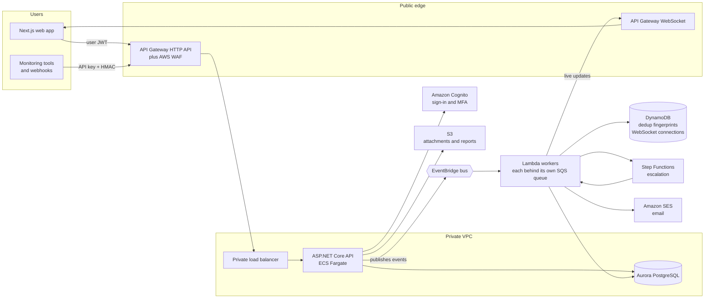
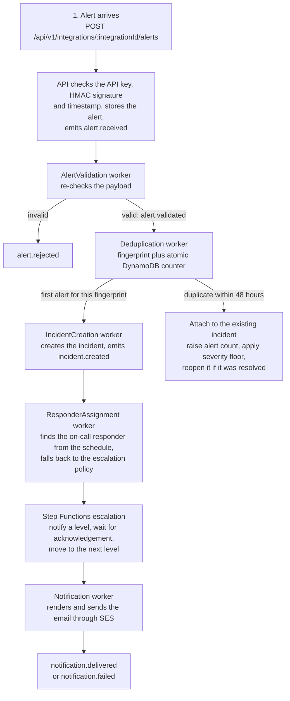

# SentinelOps

[](LICENSE)


**An incident-response platform for security and operations teams.** SentinelOps takes in alerts from monitoring tools, collapses noisy duplicates into a single incident, works out who is on call, escalates automatically until someone acknowledges, and keeps a complete audit trail. It is built as a multi-tenant SaaS on AWS.

## The 30-second version

| | |
| --- | --- |
| **The problem** | One outage fires dozens of alerts. Nobody knows which ones matter, who owns them, or whether anyone has picked them up. |
| **What SentinelOps does** | Ingest alert, deduplicate, open an incident, page the on-call responder, escalate if nobody acknowledges, track the incident to resolution, produce a report. |
| **How it is built** | A multi-tenant REST API (ASP.NET Core), an event-driven pipeline of Lambda workers, and a Next.js web app. All infrastructure is defined as code with AWS CDK. |
| **Size** | About 22,000 lines of C# and TypeScript, 10 Lambda workers, 9 CDK stacks, and 190+ automated tests across the API, workers and infrastructure. |

**Where to look first** if you want to judge the engineering quickly:

| Topic | Files |
| --- | --- |
| Multi-tenant isolation | [`SentinelOpsDbContext.cs`](apps/api/Data/SentinelOpsDbContext.cs), [`OrganizationRoleAuthorizationHandler.cs`](apps/api/Tenancy/OrganizationRoleAuthorizationHandler.cs) |
| Signed webhook ingestion | [`apps/api/Ingestion/`](apps/api/Ingestion) |
| Making at-least-once delivery safe | [`IdempotencyGuard.cs`](apps/workers/SentinelOps.Workers.Shared/IdempotencyGuard.cs), [`OutboxItem.cs`](apps/workers/SentinelOps.Workers.Shared/OutboxItem.cs), [`SqsBatchProcessor.cs`](apps/workers/SentinelOps.Workers.Shared/SqsBatchProcessor.cs) |
| Alert deduplication | [`Deduplication/Function.cs`](apps/workers/SentinelOps.Workers.Deduplication/Function.cs) |
| Escalation workflow | [`event-processing-stack.ts`](infrastructure/lib/stacks/event-processing-stack.ts) |
| Infrastructure as code | [`infrastructure/lib/stacks/`](infrastructure/lib/stacks) |
| Why things are the way they are | [`docs/adr/`](docs/adr), [`docs/security/threat-model.md`](docs/security/threat-model.md) |

---

## Contents

1. [What it does](#what-it-does)
2. [Architecture](#architecture)
3. [Life of an alert](#life-of-an-alert)
4. [Features](#features)
5. [Engineering highlights](#engineering-highlights)
6. [Tech stack](#tech-stack)
7. [Repository layout](#repository-layout)
8. [Getting started](#getting-started)
9. [Try the API](#try-the-api)
10. [Testing](#testing)
11. [CI/CD](#cicd)
12. [Documentation](#documentation)
13. [Project status and roadmap](#project-status-and-roadmap)

---

## What it does

Teams connect their monitoring tools to SentinelOps through **integrations**. Each integration has its own API key and signing secret. When a tool sends an alert, SentinelOps:

1. **Validates and stores** it, after checking the key, the signature and the timestamp.
2. **Deduplicates** it by fingerprint, so a flapping check that fires 200 times produces one incident, not 200.
3. **Opens an incident** and works out who should respond, using on-call schedules first and escalation policies as a fallback.
4. **Notifies and escalates.** If the responder does not acknowledge in time, the next level of the escalation policy is notified, and so on, until someone acknowledges or the policy is exhausted.
5. **Tracks the incident** through its lifecycle (comments, timeline, attachments, status changes) and keeps an immutable audit log.
6. **Reports.** Post-incident reports can be generated as HTML or PDF.

Everything is scoped to an **organization** (the tenant). Users can belong to several organizations and switch between them, with four roles: Viewer, Responder, Administrator and Owner.

## Architecture



| Component | Responsibility |
| --- | --- |
| **Web app** (`apps/web`) | Next.js UI. Talks to the API only from the server side; the session lives in an httpOnly cookie. |
| **API** (`apps/api`) | The system of record. REST endpoints for organizations, incidents, schedules and so on, plus the signed ingestion endpoint. Runs on ECS Fargate behind a private load balancer, so the only public door is API Gateway with WAF. |
| **Workers** (`apps/workers`) | Lambda functions that process the event pipeline. Each one is fed by its own SQS queue with a dead-letter queue. |
| **EventBridge** | The event backbone. Rules route each event type to the right queue. |
| **PostgreSQL (Aurora Serverless v2)** | Relational data: organizations, incidents, schedules, audit log. |
| **DynamoDB** | Fast, atomic state: alert fingerprints for deduplication and live WebSocket connections. |
| **Step Functions** | The escalation workflow (wait for acknowledgement, then escalate to the next level). |
| **Cognito** | Sign-up, sign-in, password reset and TOTP multi-factor authentication. |
| **S3 + GuardDuty** | Attachment and report storage. Uploaded files are malware-scanned before they can be downloaded. |

The reasoning behind each major choice is written up as an [Architecture Decision Record](docs/adr/README.md).

## Life of an alert



Three more consumers watch the same bus:

- **Analytics** records every event.
- **AuditLog** records every event with no human actor (system activity).
- **Dashboard broadcast** pushes selected incident and alert events to connected browsers over WebSocket, so the dashboard updates live. The WebSocket connect step checks both the user's token and their membership of the organization.

Alert fingerprints combine the organization, title, error code, service and environment. Volume also raises severity: at 5 alerts an incident is at least High, and at 20 it is Critical. Severity is only ever raised, never lowered.

## Features

**Alerting and incidents**
- Signed webhook ingestion with idempotency keys, replay protection and per-integration key rotation and revocation
- Automatic deduplication, severity escalation by volume, and reopen-on-recurrence
- Incident workflow: Triggered, Assigned, Acknowledged, Investigating, Monitoring, Resolved, Reopened, with full status history
- Comments (including internal ones), a chronological timeline, tags, related incidents and file attachments
- Post-incident reports as HTML and PDF

**On-call and escalation**
- Schedules with weekly rotations, time zones and one-off overrides
- Multi-level escalation policies with several targets per level
- Per-user notification preferences and an in-app notification list

**Organizations and access control**
- Multi-tenant organizations, memberships and email invitations that expire after 7 days
- Role-based access: Viewer, Responder, Administrator, Owner (each role includes the ones below it)
- Services, service dependencies and alert rules to model what is being monitored
- Audit log of who did what, from where

**Security and accounts**
- Email sign-up with verification code, password reset, and optional TOTP multi-factor authentication
- Dashboard metrics endpoint for open incidents, response and resolution times

## Engineering highlights

These are the parts that took the most thought. Each one links to where it lives.

| Concern | Approach |
| --- | --- |
| **Tenant isolation** | Every tenant-owned table has an EF Core global query filter on the current organization. The filter is *default-closed*: until the authorization handler has checked the caller's active membership and set the organization, queries return nothing. One handler decides access, so controllers never re-implement it. |
| **At-least-once delivery** | SQS delivers messages more than once. Each worker records a claim per `(worker, eventId)` in the database before acting, so a duplicate delivery does nothing. The claim is completed only after the follow-up events are published, and the pending events are saved with the claim, so a crash between "commit" and "publish" is replayed rather than lost. See `IdempotencyGuard` and `OutboxItem`. |
| **Poison messages** | Workers run with partial batch responses. One bad message is retried on its own and, after 5 attempts, lands in a dead-letter queue instead of failing the whole batch. |
| **Race-free deduplication** | The first-alert decision is made by an atomic DynamoDB update, so two concurrent alerts cannot both decide they are first. Alert counts are incremented in SQL instead of read-modify-write, so concurrent updates are not lost. |
| **Escalation** | Modeled as a Step Functions state machine instead of timers in application code. Each step is idempotent, so a retried step never notifies the same level twice. |
| **Secure ingestion** | API keys are shown once and stored only as SHA-256 hashes. Payloads are signed with HMAC-SHA256 over `timestamp.body`, with a 5-minute clock window and constant-time comparison, plus idempotency keys. |
| **Safe file handling** | Direct-to-S3 uploads through presigned URLs, a content-type allowlist and 25 MB cap, tenant-prefixed object keys that are re-checked on confirmation, sanitized file names, and downloads blocked until the GuardDuty malware scan comes back clean. |
| **Output encoding** | Reports and emails HTML-encode all user-provided text. |
| **Defense in depth** | WAF managed rules and a per-IP rate rule, a private load balancer, KMS encryption, TLS enforced on database connections, automatic secret rotation, security headers on every response, and a written [threat model](docs/security/threat-model.md). |
| **Observability** | Structured JSON logs with correlation IDs, custom CloudWatch metrics (request count, latency, acknowledgement and resolution times, duplicate alerts), X-Ray tracing, alarms for errors, latency, Lambda failures, dead-letter queue depth and database connections, and a monthly AWS Budget. |
| **Infrastructure as code** | Nine CDK stacks (network, database, storage, authentication, API, event processing, observability, frontend, CI/CD). Each has assertion tests, and environments (dev, staging, production) differ only by configuration. |
| **Keyless deployments** | GitHub Actions deploys to AWS through OpenID Connect, so no long-lived AWS keys are stored in the repository settings. |

## Tech stack

| Layer | Technology |
| --- | --- |
| Web | Next.js 16 (App Router), React 19, TypeScript, Tailwind CSS 4, shadcn/ui, react-hook-form, Zod |
| API | ASP.NET Core on .NET 10, Entity Framework Core 10, Npgsql, QuestPDF |
| Workers | AWS Lambda (.NET 10), SQS, EventBridge, DynamoDB, Step Functions, SES |
| Data | Aurora PostgreSQL Serverless v2, DynamoDB, S3 |
| Identity | Amazon Cognito with TOTP MFA |
| Infrastructure | AWS CDK (TypeScript) |
| Observability | CloudWatch (logs, metrics, alarms), X-Ray, AWS Budgets |
| Testing | xUnit and Testcontainers, Vitest, Jest (CDK assertions), Playwright, k6 |
| CI/CD | GitHub Actions with OIDC |

## Repository layout

```
SentinelOps/
├── apps/
│   ├── api/              ASP.NET Core API (controllers, EF Core model, migrations, tenancy)
│   ├── api.Tests/        API integration tests (real PostgreSQL via Testcontainers)
│   ├── web/              Next.js web app
│   ├── workers/          Lambda workers, one project per worker, plus shared libraries
│   │   ├── SentinelOps.Events/              Event contracts, serialization, schema checks
│   │   ├── SentinelOps.Workers.Shared/      Idempotency, outbox, batch handling, DB access
│   │   └── SentinelOps.Workers.*/           AlertValidation, Deduplication, IncidentCreation,
│   │                                        ResponderAssignment, Escalation, Notification,
│   │                                        AuditLog, Analytics, AttachmentScan, Dashboard
│   └── workers.Tests/    Worker tests
├── infrastructure/       AWS CDK app: stacks, event JSON schemas, stack tests, ops scripts
├── tests/
│   ├── e2e/              Playwright smoke tests for a deployed environment
│   └── load/             k6 load test for the ingestion endpoint
├── docs/                 ADRs, threat model, security assumptions, runbooks, cost estimate
├── .github/workflows/    CI, CD, dependency audit, container scan, SQL safety check
└── docker-compose.yml    Local PostgreSQL, Redis, API and web app
```

## Getting started

### Prerequisites

- Docker and Docker Compose
- .NET SDK 10 (for the API, the tests and database migrations)
- Node.js 20 or newer (CI uses 22)
- An **Amazon Cognito user pool and app client**. Sign-up and sign-in go through real Cognito, and there is no local emulator. You need three values: the region, the user pool ID and the app client ID. They are the `Region`, `UserPoolId` and `UserPoolClientId` outputs of the authentication stack in `infrastructure/`. Without them the API logs a warning at startup and account creation returns a 503.

### Run it locally

1. **Configure the environment.**

   ```bash
   cp .env.example .env
   ```

   Fill in `Cognito__Region`, `Cognito__UserPoolId` and `Cognito__ClientId` in `.env`.

2. **Start the database and create the schema.** Migrations are not applied automatically yet, so run them once:

   ```bash
   docker compose up -d postgres
   dotnet tool install --global dotnet-ef        # skip if already installed
   dotnet ef database update --project apps/api
   ```

   This uses the default connection string in `apps/api/appsettings.json` (`localhost:5432`, user and password `sentinelops`), which matches the Postgres container.

3. **Start everything.**

   ```bash
   docker compose up --build
   ```

   | Service | URL |
   | --- | --- |
   | Web app | http://localhost:3000 |
   | API | http://localhost:5000 (health check at `/healthz`, OpenAPI document at `/openapi/v1.json`) |
   | PostgreSQL | localhost:5432 |

4. **Create an account.** Open the web app, choose *Create account*, enter the verification code that Cognito emails you, then sign in.

### Running without Docker

Keep PostgreSQL running (`docker compose up -d postgres`, with migrations applied as in step 2). Start the API with `dotnet run --project apps/api --launch-profile http` (it listens on port 5054) and the web app with `npm run dev` inside `apps/web`. Point the web app at the API by creating `apps/web/.env.local` containing `NEXT_PUBLIC_API_URL=http://localhost:5054`, and provide the three Cognito variables as environment variables for the API (`Cognito__Region`, `Cognito__UserPoolId`, `Cognito__ClientId`).

## Try the API

The API is the source of truth, and it is the quickest way to see the data model and the security model working. Steps 1 to 3 run locally and need only the Cognito setup above. Step 4 publishes to EventBridge, so it needs AWS. Examples assume the API is at `http://localhost:5000`, you are in a Bash shell, and `jq` is installed.

**1. Sign in and create an organization.** The creator becomes its Owner.

```bash
API=http://localhost:5000

TOKEN=$(curl -s $API/api/v1/auth/login \
  -H 'Content-Type: application/json' \
  -d '{"email":"you@example.com","password":"YourPassword1!"}' | jq -r .tokens.accessToken)

ORG=$(curl -s $API/api/v1/organizations \
  -H "Authorization: Bearer $TOKEN" -H 'Content-Type: application/json' \
  -d '{"name":"Acme"}' | jq -r .id)
```

If your account has MFA enabled, `login` returns an `mfaChallenge` instead of tokens; complete it with `POST /api/v1/auth/mfa/verify`. Everything inside an organization lives under `/api/v1/organizations/{orgId}/...` (incidents, services, schedules, escalation policies, members and more).

**2. Create a service.** A service is the thing being monitored. It needs an owner (you here) and an environment (`0` Production, `1` Staging, `2` Development).

```bash
USER_ID=$(curl -s $API/api/v1/organizations/$ORG/members \
  -H "Authorization: Bearer $TOKEN" | jq -r '.[0].userId')

SERVICE=$(curl -s $API/api/v1/organizations/$ORG/services \
  -H "Authorization: Bearer $TOKEN" -H 'Content-Type: application/json' \
  -d "{\"name\":\"Checkout\",\"ownerUserId\":\"$USER_ID\",\"environment\":0}" | jq -r .id)
```

**3. Create an integration.** This is the credential a monitoring tool uses to send alerts. The response shows the **API key and signing secret once**; only a hash of the key is stored.

```bash
RESP=$(curl -s -X POST $API/api/v1/organizations/$ORG/services/$SERVICE/integrations \
  -H "Authorization: Bearer $TOKEN" -H 'Content-Type: application/json' \
  -d '{"name":"CloudWatch","provider":"cloudwatch"}')

INTEGRATION_ID=$(echo "$RESP" | jq -r .integration.id)
API_KEY=$(echo "$RESP" | jq -r .apiKey)
SIGNING_SECRET=$(echo "$RESP" | jq -r .signingSecret)
```

**4. Send a signed alert.** Ingestion publishes an `alert.received` event to EventBridge, so the API needs AWS credentials and `Aws__EventBridge__Region` and `Aws__EventBridge__EventBusName` set. The local Docker Compose stack does not provide these, so run this step against a deployed environment (set `API` to its URL) or an API running with your own AWS credentials.

```bash
BODY="{\"externalId\":\"alarm-123\",\"source\":\"cloudwatch\",\"title\":\"High error rate on checkout\",\"severity\":1,\"timestampUtc\":\"$(date -u +%Y-%m-%dT%H:%M:%SZ)\",\"environment\":\"production\"}"
TS=$(date +%s)
SIG=$(printf '%s.%s' "$TS" "$BODY" | openssl dgst -sha256 -hmac "$SIGNING_SECRET" -hex | sed 's/^.* //')

curl -s -X POST "$API/api/v1/integrations/$INTEGRATION_ID/alerts" \
  -H "Content-Type: application/json" \
  -H "X-Api-Key: $API_KEY" \
  -H "X-SentinelOps-Timestamp: $TS" \
  -H "X-SentinelOps-Signature: sha256=$SIG" \
  -H "Idempotency-Key: alarm-123-first-delivery" \
  -d "$BODY"
```

A `202 Accepted` response means the alert was stored and handed to the pipeline. Sending the same `Idempotency-Key` again returns `"status":"duplicate"` instead of creating a second alert. A request with a bad signature, or a timestamp more than 5 minutes off, is rejected with `401`. `severity` is a number: 0 Critical, 1 High, 2 Medium, 3 Low.

From there the pipeline (validation, deduplication, incident creation, responder assignment, escalation, email) runs on the AWS event infrastructure. To see all of it, deploy the CDK stacks to an AWS account; the Lambda workers are not part of the local stack.

## Testing

| Suite | Command | Notes |
| --- | --- | --- |
| API integration and unit tests | `dotnet test apps/api.Tests` | Starts a real PostgreSQL in Docker with Testcontainers, covering tenant isolation, authorization, ingestion, attachments and more |
| Worker tests | `dotnet test apps/workers.Tests` | Covers idempotency, deduplication, escalation, notifications and replay after a crash |
| Web unit tests | `cd apps/web && npm ci && npm test` | Vitest |
| Infrastructure tests | `cd infrastructure && npm ci && npm test` | Jest assertions against the synthesized CloudFormation of each stack |
| Smoke tests | `cd tests/e2e && npm ci && npx playwright test` | Needs `E2E_API_URL` and `E2E_FRONTEND_URL` for a deployed environment |
| Load test | `k6 run tests/load/alert-ingestion.js` | Ramps to 20 virtual users with a 95th-percentile latency target of 500 ms. See the file header for the required variables |

## CI/CD

**CI** (on every pull request and push to `main`) runs formatting checks (`dotnet format`, Prettier), linting, the backend, frontend and infrastructure tests, builds the API and web app, and runs `cdk synth`. Separate workflows run a dependency audit, a container image scan and a SQL safety check.

**CD** (after CI succeeds on `main`) builds container images and deploys with CDK to **staging**, runs end-to-end smoke tests, then waits for a required reviewer before deploying to **production**. AWS access uses short-lived OpenID Connect credentials. See [rollback procedures](docs/deployment/rollback.md).

## Documentation

| Document | What it covers |
| --- | --- |
| [Architecture Decision Records](docs/adr/README.md) | Why ASP.NET Core, PostgreSQL, EventBridge, SQS, Step Functions, DynamoDB, ECS Fargate and Lambda were chosen for their roles |
| [Threat model](docs/security/threat-model.md) | Assets, threats, mitigations and accepted residual risks per component |
| [Security assumptions](docs/security/security-assumptions.md) | Design decisions that security depends on, and their known limits |
| [Rollback procedures](docs/deployment/rollback.md) | How to roll back an API or infrastructure change, and the one-time AWS and GitHub setup |
| [Cleanup and cost control](docs/deployment/cleanup.md) | Pausing dev, deleting stale snapshots, tearing an environment down |
| [Cost estimate](docs/costs.md) | The reasoning behind each environment's budget |

## Project status and roadmap

SentinelOps is a portfolio project that I built end to end: product design, backend, event pipeline, frontend and cloud infrastructure.

| Area | Status |
| --- | --- |
| API | Implemented for all the features above, with integration tests against real PostgreSQL |
| Event pipeline | Implemented from alert ingestion through escalation and email notification, with worker tests |
| Infrastructure | All stacks defined in CDK with assertion tests |
| Web app | Sign-up, email verification, sign-in, MFA, password reset, organization switcher, incident list and MFA setup. The remaining screens (dashboard widgets, events, accounts, users, organization and integration management) are scaffolded and are the main area still to build |

**Next steps**
- Run database migrations automatically as part of deployment
- Build the web screens for organizations, invitations, services, schedules, escalation policies and incident management
- Write API changes and the events they trigger in a single database transaction (a transactional outbox), the way the workers already do
- Refresh expiring sessions in the Next.js proxy so the dashboard never serves a stale token
- Add a production Dockerfile for the web app and settle on one hosting path for it
- Add end-to-end tests for the sign-up and sign-in flows

## License

[MIT](LICENSE)
